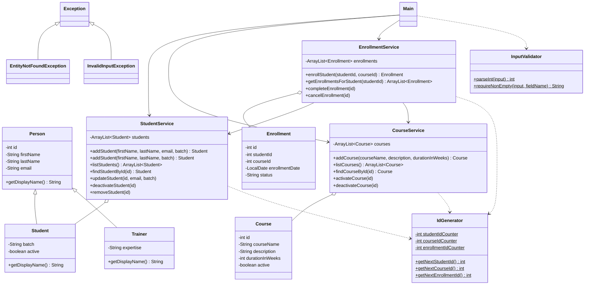

# LearnTrack - Student & Course Management System

My LearnTrack project for the Airtribe Java cohort. It's a console app where an admin can manage students, courses and enrollments from a menu. Data is kept in ArrayLists, so it's gone once you exit.

## What it does

- Students: add (email is optional), view all, search by ID, update email and batch, deactivate
- Courses: add, view all, activate or deactivate
- Enrollments: enroll a student in a course, view a student's enrollments, mark one as completed or cancelled

You can't enroll someone in a deactivated course, or in the same course twice while the first enrollment is still active. Wrong input (letters instead of a number, a menu option that doesn't exist, an ID that doesn't exist, an empty name) just shows a message and asks again.

## Structure

```
src/main/java/com/airtribe/learntrack/
    entity/      Person, Student, Trainer, Course, Enrollment
    service/     StudentService, CourseService, EnrollmentService
    exception/   EntityNotFoundException, InvalidInputException
    util/        IdGenerator, InputValidator
    ui/          Main
docs/            setup, JVM basics, design notes
```

Entities hold the data, services have the logic, and Main only shows the menus and calls the services.

## How to run

Needs JDK 21 or newer.

In IntelliJ, open the project folder, wait for Gradle to load, and run `ui/Main.java`.

From the terminal:

```bash
./gradlew build
java -cp build/classes/java/main com.airtribe.learntrack.ui.Main
```

Or without Gradle:

```bash
javac -d out $(find src/main/java -name "*.java")
java -cp out com.airtribe.learntrack.ui.Main
```

## Class diagram



`$` = static, `-` = private, `+` = public

## Docs

- [Setup instructions](docs/Setup_Instructions.md)
- [JVM basics](docs/JVM_Basics.md)
- [Design notes](docs/Design_Notes.md)
