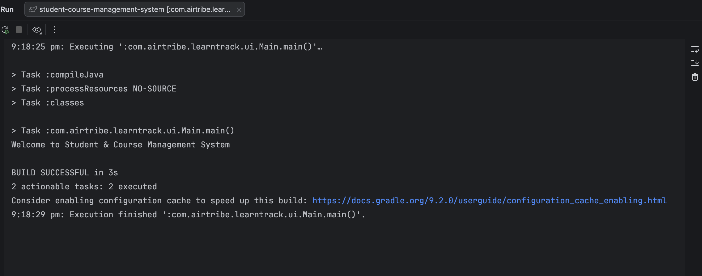

# Setup Instructions

## JDK version

I'm on a Mac and have two JDKs installed:

- OpenJDK 25.0.2 - set as the project SDK in IntelliJ
- OpenJDK 21.0.10 (Homebrew) - the default java in my terminal

The project works on both. Checking from the terminal:

```
$ java -version
openjdk version "21.0.10" 2026-01-20
OpenJDK Runtime Environment Homebrew (build 21.0.10)
OpenJDK 64-Bit Server VM Homebrew (build 21.0.10, mixed mode, sharing)
```

If you don't have a JDK, IntelliJ can download one (File > Project Structure > SDK > Download JDK), or on Mac you can use `brew install openjdk@21`.

## Hello World

I created the project in IntelliJ as a Java + Gradle project, added the packages, and before writing anything else I ran a simple Main to check the setup:

```java
package com.airtribe.learntrack.ui;

public class Main {
    public static void main(String[] args) {
        System.out.println("Welcome to Student & Course Management System");
    }
}
```

Running it with the green arrow next to main, IntelliJ compiles it through Gradle and prints the message:



Same thing from the terminal:

```
$ ./gradlew compileJava
$ java -cp build/classes/java/main com.airtribe.learntrack.ui.Main
Welcome to Student & Course Management System
```

One thing that tripped me up in a practice project: I opened the parent folder in IntelliJ instead of the project folder, so it didn't pick up Gradle and the run button never showed up. Opening the project folder itself fixed it.
